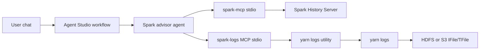

# SparkLogAgent

A Cloudera Agent Studio chatbot for Spark troubleshooting and optimization. One conversational agent uses two MCP servers:

- The [Spark History Server MCP](https://github.com/jvprosser/mcp-apache-spark-history-server) for jobs, stages, SQL, executors, and configuration.
- A log MCP in this repo that asks a cluster-side utility to run `yarn logs`.

`yarn logs` reads the aggregated IFile/TFile containers and prints container stdout and stderr. Completed applications are stored at:

- On-prem: `hdfs:///tmp/logs/<user>/logs/application_<id>`
- CDP Data Hub on AWS: `s3a://<cdp-environment-bucket>/logs/<user>/logs/application_<id>`

The log MCP does not open those paths. Agent Studio can only start a local stdio MCP, so the MCP registered in the workbench is a proxy.



## Log utility

Run the utility on a host that has the `yarn` client, `kinit`, `krb5.conf`, and a route to the KDC. It obtains a ticket for the workflow principal, runs `yarn logs` with that credential cache, and destroys the cache.

```bash
export SPARK_LOGS_API_TOKEN="replace-me"
export SPARK_LOGS_TLS_CERT="/path/server.pem"
export SPARK_LOGS_TLS_KEY="/path/server.key"
export SPARK_LOGS_BIND="0.0.0.0"
export SPARK_LOGS_PORT="8443"
spark-logs-utility
```

`SPARK_LOGS_BIND` defaults to `127.0.0.1`. Set it to an address the workbench can reach, and keep that port on a network that only the workbench uses.

The utility accepts `POST` requests with a bearer token. The JSON body carries `username` and `password`. Optional fields are `container_id`, `log_type` (`stdout` or `stderr`), `app_owner`, `pattern`, and `tail_lines`.

- `POST /applications/{application_id}/logs` runs `yarn logs -applicationId <id> -show_container_log_info`
- `POST /applications/{application_id}/logs/content` runs `yarn logs -applicationId <id>` with optional `-containerId`, `-log_files`, and `-appOwner`

Application and container ids are checked against the YARN id pattern and passed as an argument list. A literal `pattern` is applied in the utility, then the result is tailed and capped. A rejected password is not retried.

## Register the MCP servers

In Agent Studio, open Tools Catalog, then MCP Servers, and register each JSON file. Use placeholder values in the file. Agent Studio asks for the real values when you attach the server to the agent.

- [mcp/spark-history-server.json](mcp/spark-history-server.json) is pinned to commit `e058c872832c3d5e76ddf5e35cb347ad96b6e86e`. Set `SHS_SERVERS__LOCAL__URL` to the History Server. Fill the auth variables when that server requires them.
- [mcp/spark-logs.json](mcp/spark-logs.json) points at this repository. Set `SPARK_LOGS_API_URL` to the utility's `https://` address, `SPARK_LOGS_API_TOKEN` to the same token the utility uses, and `SPARK_LOGS_CA_CERT` when the utility certificate is signed by a private CA. `WORKLOAD_USER` and `WORKLOAD_PASSWORD` are the on-prem Kerberos principal and password.

Enable the History Server tools and both log tools named in [agent/spark_advisor.md](agent/spark_advisor.md). Leave History Server tools that write configuration, and the AWS recommendation tools, off.

## Workflow

Create one conversational workflow and leave the manager agent off. Paste the role, goal, backstory, task, and expected output from [agent/spark_advisor.md](agent/spark_advisor.md).

Every chat uses the workload principal stored on the workflow. YARN log ACLs apply to that principal. The password is stored in the workflow MCP configuration, sent to the utility in the request body, and never included in a tool argument.

## Development

```bash
uv venv --python 3.12 .venv
uv pip install --python .venv/bin/python -e ".[dev]"
.venv/bin/pytest
```

Tests use fake `kinit`, `kdestroy`, and `yarn` programs. They do not need HDFS, S3, or a KDC.
