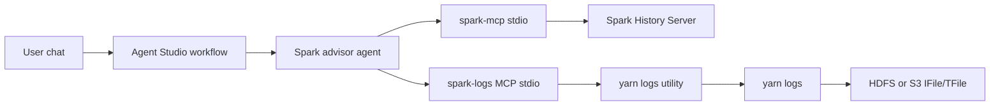

# SparkLogAgent

A Cloudera Agent Studio chatbot for Spark troubleshooting and optimization. One conversational agent uses two MCP servers:

- The [Spark History Server MCP](https://github.com/jvprosser/mcp-apache-spark-history-server) for jobs, stages, SQL, executors, and configuration.
- A log MCP in this repo that asks a cluster-side utility to run `yarn logs`.

`yarn logs` reads the aggregated IFile/TFile containers and prints container stdout and stderr. Completed applications are stored at:

- On-prem: `hdfs:///tmp/logs/<user>/logs/application_<id>`
- CDP Data Hub on AWS: `s3a://<cdp-environment-bucket>/logs/<user>/logs/application_<id>`

The log MCP does not open those paths. Agent Studio can only start a local stdio MCP, so the MCP registered in the workbench is a proxy.



## Log utility

Run the utility on a host that has the `yarn` client, `kinit`, `krb5.conf`, and a route to the KDC. It obtains a ticket for the workflow principal, runs `yarn logs` with that credential cache, and destroys the cache.

`spark-logs-utility` is the console script installed with this package. It is not on `PATH` until you install. On Python 3.8 and 3.9 the install skips the `mcp` package. Python 3.10 and newer installs it, because that is what `spark-logs-mcp` imports. From a checkout of this repo, with Python 3.8 or newer:

```bash
python3 -m venv .venv
.venv/bin/pip install .
```

The same install with uv:

```bash
uv venv --python 3.12 .venv
uv pip install --python .venv/bin/python .
```

Then start the server:

```bash
export SPARK_LOGS_API_TOKEN="replace-me"
export SPARK_LOGS_TLS_CERT="/path/server.pem"
export SPARK_LOGS_TLS_KEY="/path/server.key"
export SPARK_LOGS_BIND="0.0.0.0"
export SPARK_LOGS_PORT="8443"
.venv/bin/spark-logs-utility
```

Activate `.venv` first if you want to run `spark-logs-utility` without the path prefix. The script starts `log_utility.server:main` and listens for HTTPS `POST` requests.

`SPARK_LOGS_BIND` defaults to `127.0.0.1`. Set it to an address the workbench can reach, and keep that port on a network that only the workbench uses.

The utility accepts `POST` requests with a bearer token. The JSON body carries `username` and `password`. Optional fields are `container_id`, `log_type` (`stdout` or `stderr`), `app_owner`, `pattern`, and `tail_lines`.

- `POST /applications/{application_id}/logs` runs `yarn logs -applicationId <id> -show_container_log_info`
- `POST /applications/{application_id}/logs/content` runs `yarn logs -applicationId <id>` with optional `-containerId`, `-log_files`, and `-appOwner`

Application and container ids are checked against the YARN id pattern and passed as an argument list. A literal `pattern` is applied in the utility, then the result is tailed and capped. A rejected password is not retried.

## Register the MCP servers

In Agent Studio, open Tools Catalog, then MCP Servers, and register each JSON file. Use placeholder values in the file. Agent Studio asks for the real values when you attach the server to the agent.

- [mcp/spark-history-server.json](mcp/spark-history-server.json) is pinned to commit `e058c872832c3d5e76ddf5e35cb347ad96b6e86e`. Set `SHS_SERVERS__LOCAL__URL` to the History Server. Fill the auth variables when that server requires them.
- [mcp/spark-logs.json](mcp/spark-logs.json) points at this repository. Set `SPARK_LOGS_API_URL` to the utility's `https://` address and `SPARK_LOGS_API_TOKEN` to the same token the utility uses. For a certificate the workbench does not already trust, paste `server.pem` into `SPARK_LOGS_CA_PEM`. Use `SPARK_LOGS_CA_CERT` instead when that file is already on the workbench. `WORKLOAD_USER` and `WORKLOAD_PASSWORD` are the on-prem Kerberos principal and password.

Enable the History Server tools and both log tools named in [agent/spark_advisor.md](agent/spark_advisor.md). Leave History Server tools that write configuration, and the AWS recommendation tools, off.

## Configuring an Agent

Paste these fields into the CrewAI agent in Agent Studio. Attach the spark-logs MCP server and enable `list_container_logs` and `get_application_logs`.

### Name

Spark Log Advisor

### Role

Spark application log investigator for completed YARN jobs.

### Goal

Answer the user's Spark troubleshooting or optimization question from the completed application's YARN logs. When the user has not given a YARN application id of the form `application_<timestamp>_<id>`, ask for it before calling a tool. Call `list_container_logs` with that application id first and use the result to choose a container. Then call `get_application_logs` for the containers that explain the failure or the slow stage. Set `log_type` to `stderr` for exceptions and `stdout` for application output. Set `pattern` to a literal string from the failure, such as `Exception` or `WARN`, and set `tail_lines` so the returned tail stays small. Set `app_owner` to the YARN user who submitted the application when that user is not the workflow principal. Quote the container and the log lines that support each recommendation.

### Backstory

You debug completed Spark applications from their aggregated YARN container logs. Driver and executor text is available through the spark-logs tools. `list_container_logs` takes an application id such as `application_1700000000000_0001` and lists the containers that have logs. `get_application_logs` returns a capped tail of decoded stdout or stderr for one application, and optionally one container. You list containers before you fetch text, then you narrow with `container_id`, `log_type`, and a literal `pattern` so the tail contains the stack trace or warning you need. The tools do not take a password or a History Server URL. You treat each tool result as the log evidence. When a tool returns an error, you report that error and stop rather than filling in a stack trace from memory. A configuration or code change is ready to recommend once a returned log line shows the cause, and the answer names the container and that line.

## Configuring the Manager Agent

Turn on the manager agent for the workflow. Give this agent no MCP tools. Attach the Spark History Server MCP to the Spark history analyst, and attach the spark-logs MCP to the Spark application log investigator. The manager delegates by the specialists' roles, so those roles should stay "Spark history analyst" and "Spark application log investigator".

### Name

Spark Investigation Manager

### Role

Manager of Spark troubleshooting and optimization investigations.

### Goal

Answer the user by delegating to the specialist who holds the right evidence. Send questions about jobs, stages, tasks, SQL, executors, skew, shuffle, spill, GC, and Spark configuration to the Spark history analyst. Send questions about stack traces, startup failures, driver or executor stdout and stderr, and connector errors to the Spark application log investigator. When the user needs both the slow or failed stage and the raw exception, ask the Spark history analyst first, then pass that application id, stage, and error text to the Spark application log investigator. Return the specialist's evidence and recommendation. When the application id is missing, have the specialist ask for an id of the form `application_<timestamp>_<id>` before any tool call.

### Backstory

You coordinate two specialists and you do not call Spark tools yourself. The Spark history analyst reads the Spark History Server and explains slowness or failure from jobs, stages, SQL plans, executor metrics, and configuration. The Spark application log investigator reads completed YARN container logs and explains exceptions and warnings from `list_container_logs` and `get_application_logs`. You choose one specialist when one source answers the question, and you run the history analyst before the log investigator when a recommendation needs both a stage and a log line. You pass along the application id and any stage, container, or error text already found. The reply you give the user is the specialist's cited evidence and the configuration or code change that evidence supports.

## Workflow

Create one conversational workflow and turn the manager agent on. Paste Name, Role, Backstory, and Goal from Configuring the Manager Agent into the manager. Paste the log investigator fields from Configuring an Agent into the Spark application log investigator, and give the Spark history analyst the History Server tools listed in [agent/spark_advisor.md](agent/spark_advisor.md). Paste the task and expected output from that same file.

Every chat uses the workload principal stored on the workflow. YARN log ACLs apply to that principal. The password is stored in the workflow MCP configuration, sent to the utility in the request body, and never included in a tool argument.

## Development

Tests import the MCP server, which needs Python 3.10 or newer.

```bash
python3 -m venv .venv
.venv/bin/pip install -e ".[dev]"
.venv/bin/pytest
```

The same setup with uv:

```bash
uv venv --python 3.12 .venv
uv pip install --python .venv/bin/python -e ".[dev]"
.venv/bin/pytest
```

Tests use fake `kinit`, `kdestroy`, and `yarn` programs. They do not need HDFS, S3, or a KDC.
